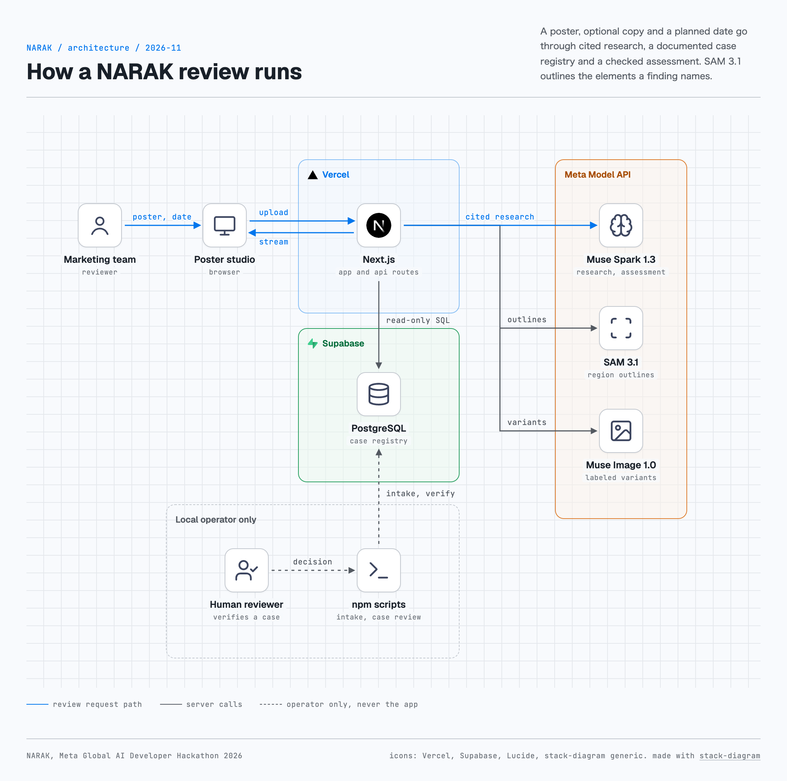

# NARAK

NARAK helps Korean marketing teams check what a poster, its ad copy and its planned publication date could mean in South Korean cultural context before the campaign runs. It researches cited public sources, checks a registry of documented cases and shows each finding on the poster with its evidence trail. It never gives a risk score and never approves a campaign.

NARAK was built for the Meta Global AI Developer Hackathon. The live site is at https://www.narakcheck.com/, and the three minute demo video is at [demo video](https://drive.google.com/file/d/1D2apsJObOEJmUGmvdtQHTzIPxdkZlxw4/view?usp=sharing).

<picture>
  <source media="(prefers-color-scheme: dark)" srcset="docs/architecture-dark.png">
  
</picture>

## The problem

A marketing review checks what an ad literally says and shows. The same image, wording or date can carry a meaning in Korea that the team does not see, such as a hand gesture that an online community has adopted or a launch date that falls on a painful anniversary. Static blocklists miss meanings that appear later, and an unconstrained AI review can make unsupported allegations about a brand.

## Who it is for

NARAK is for brand, marketing and agency teams who publish in South Korea and want a second look at a creative before it goes live. The hackathon theme is Build for Your World, and NARAK answers it by starting from one market and its online culture.

## How a review works for the user

1. Open the site, drop a poster (JPEG, PNG or WebP up to 4 MB) or pick a sample, add ad copy if you have it in Korean or English, and choose the date it runs.
2. Press Review poster. The poster goes to Meta for the review, and NARAK does not save uploads or results.
3. Watch How a review works in the left column. Each step is marked from the events the server streams as they happen, including the number of cited pages and any retry. A review can take up to five minutes.
4. Read the outcome, step through the findings marked on the poster and open the evidence panel. It shows the cited pages, the documented case notes, the counterarguments and the model's own inference about your creative, each labeled by source.
5. If a finding is outlined, test a controlled variant of that element. Then edit the poster, copy or date and review again, or review another poster.

Reviews use live web research, so the outcome can change between runs.

## How the Meta models are used

NARAK calls Meta's models through the Meta Model API from the server. Muse Spark 1.3 is Meta's reasoning model, SAM 3.1 is Meta's Segment Anything Model for locating objects in an image, and Muse Image 1.0 is Meta's image editing model.

- **Muse Spark 1.3 researches.** The first call uses Meta's web search tool with at most eight tool calls. Only native `url_citation` annotations become sources. The same call transcribes the words printed on the poster for later checks.
- **Muse Spark 1.3 compares imagery.** When a documented case has an imagery cue, one low effort structured call compares the poster with those cues. It sees the poster, the cue text and the candidate case IDs only.
- **Muse Spark 1.3 assesses.** A separate call at low reasoning effort sees the poster, the copy, the cited passages, the selected case notes and the poster transcription, and returns a strict JSON assessment. Server rules then remove findings that break NARAK's evidence rules. Examples are findings outside NARAK's scope, findings whose reaction source is a general guide or only an encyclopedia page, image findings with no clear visible match, and wording findings whose quoted phrase does not appear in the copy or the transcription. Research and the assessment each retry once when the deadline allows.
- **SAM 3.1 locates.** SAM 3.1 outlines up to three elements that the findings name, and NARAK reads its output with Meta's `@meta-sam/parser`. An outline shows position only and never adds meaning.
- **Muse Image 1.0 makes a labeled variant.** For an outlined element, one edit changes that element. The original and the variant are reviewed again with the same evidence and date, SAM 3.1 checks whether the element is still found, and a pixel measurement reports how much changed inside and outside the element. The variant is always labeled as a generated image.

## Evidence lifecycle and the three outcomes

Supabase is a hosted PostgreSQL service, and the registry is a PostgreSQL schema there. Each documented case holds its sources and notes, and every note keeps its kind. A note can be a reported fact, a reported interpretation, a rebuttal, a correction or model inference, and model inference never counts as evidence.

- Database triggers start every new case as emerging, keep an append only status history and lock verified material.
- `npm run evidence:discover` stages candidates on the operator's machine. A person reads each page and accepts or rejects it with `npm run evidence:review`, and intake then creates a new emerging case.
- Only a documented human review can verify a case. `npm run case:review` prints a case for review as a dry run. Writing a decision needs `--apply`, a named reviewer and a rationale, and the database still requires a reported fact from a linked source.
- Each review reads at most 50 emerging and verified cases. A note counts only when its source was published before the planned date and NARAK knew about it before that day.

A review reports one of three outcomes.

- `evidence-backed concern` is set only by the server, when a surviving finding cites a reported fact from a verified case that was available before the planned date. The model cannot set it.
- `emerging signal` reports that cited sources or emerging cases suggest a contextual concern that no person has verified yet.
- `no supported concern found` covers only the cited material checked in that review. It is never a guarantee or an approval.

A review that stops early is shown as incomplete, unavailable or failed, and never as a clear result. In the live runs on 4 November 2026 the hosted registry returned three emerging cases and no verified case, so no live review has produced an evidence-backed concern yet.

## What was built during the hackathon

The build period ran from 27 October to 4 November 2026. The public Git history records the work in commits made on 3 and 4 November 2026.

| Date | Commit | What it added |
| --- | --- | --- |
| 3 Nov | `42b47ce` | The first review flow with upload checks, cited research and an assessment, the registry schema with its lifecycle triggers, the intake script for three seed cases and the first tests |
| 3 Nov | `4264f55`, `88b39b9` | Production diagnostics with counts only, plus citation and registry reliability fixes |
| 4 Nov | `b33f6bb`, `e08fd74` | SAM 3.1 regions, labeled Muse Image variants, the discovery review step and scoped assessment checks |
| 4 Nov | `0428753` | The dark poster studio interface |
| 4 Nov | `d9c6264` | Case selection from registry data, poster text and imagery, the server derived verified outcome and the human case review command |
| 4 Nov | `af75593` | Streamed review stages, How a review works, sample posters, the favicon and the wide screen layout |

This README, the license files and the architecture diagram were added at the end of the build period.

## Stack

- Next.js 16.4 with the App Router, React 19, TypeScript and Tailwind CSS 4
- Route handlers on the Node.js runtime, hosted on the Vercel platform
- PostgreSQL on Supabase, read through a read only role with verified TLS
- zod for the request and response contracts, sharp for image checks and `pg` for database access
- Muse Spark 1.3, SAM 3.1 and Muse Image 1.0 through the Meta Model API

The server decodes and encodes every upload again with sharp before any model call, so metadata such as EXIF location never reaches Meta.

## Setup

You need Node.js 22 and a Meta Model API key. The case registry also needs a PostgreSQL database.

```sh
git clone https://github.com/starJin2003/narak.git
cd narak
npm ci
cp .env.example .env.local
npm run dev
```

Set these server only values in `.env.local`. Never put a credential in a `NEXT_PUBLIC_` variable.

| Variable | Used for |
| --- | --- |
| `MODEL_API_KEY` | The Meta Model API key |
| `DATABASE_URL` | A PostgreSQL role that can only read the `narak` schema, with `sslmode=verify-full` |
| `DATABASE_CA_CERT` or `DATABASE_CA_CERT_PATH` | The certificate authority for verified TLS |
| `DATABASE_MIGRATION_URL` | A privileged connection for the local operator scripts only, never set on Vercel |

The registry schema is `db/migrations/001_knowledge_registry.sql`. Apply it to your own database with a privileged role. Without a key the site shows that live review is unavailable. Without a registry the review reports a coverage gap, and a review with no finding ends incomplete.

## Testing

These are the commands and the counts observed on 4 November 2026 for commit `af75593`.

| Command | What runs | Result |
| --- | --- | --- |
| `npm run typecheck` | Route types and TypeScript | Passed |
| `npm run lint` | ESLint with no warnings allowed | Passed |
| `npm test` | Vitest unit and route tests | 353 passed, 61 skipped (three files need a database), 0 failed |
| `npm run build` | Production build | Passed |
| `npm run test:e2e` | Playwright in Chrome at 1440 and 390 pixels, with axe checks at 2560, 1920, 1440, 1024, 390 and 320 pixels | 71 passed, 1 skipped by design, 0 failed |
| `npm run test:knowledge-db` | Registry tests on a disposable local PostgreSQL 18.3 cluster | 29 passed |
| `npm run test:knowledge-db -- --intake` | Seed intake tests | 16 passed, 6 hosted tests skipped |
| `npm run test:knowledge-db -- --discovery` | Discovery review tests | 13 passed |
| `npm run test:knowledge-db -- --lifecycle` | Case selection, human review and the verified outcome | 10 passed |

Browser tests answer every model call with labeled fixtures, so they make no Meta call. The hosted registry tests, streaming on Vercel, Safari and Firefox, physical phones, screen readers and PostgreSQL 17 were not tested.

## Evaluation

These results come from a small sample of posters chosen by the project. They show how the pipeline behaved on those posters and are not an accuracy rate.

On 4 November 2026 the review pipeline ran 33 live reviews of posters with no ad copy, before the streaming interface was added. Six control posters echo three documented South Korean advertising controversies. Three use invented brands and ran five times each, and three name the original brands in text and ran twice each. Twelve benign posters ran once each.

- All 33 reviews completed, with no stop and no retry.
- All 21 control runs reached their own documented case through the poster's wording, the imagery check or both.
- The 12 benign posters produced no finding and selected no case.
- A blind automated classification pass rated the 24 control findings as 22 specific cultural findings and 2 unclear ones. The 2 unclear ratings came from a flaw in the test harness that hid the named control posters' drawings from the classifier.
- Runs with a relevant specific finding were 13 of 21 control runs. Four runs of one invented control and both runs of its named control ended with no finding, because the visual match rule removed six findings about a finger frame gesture.
- Outcomes were 15 emerging signals and 18 no supported concern found. No review reached an evidence-backed concern, because the registry held no verified case.
- The median review took 81.1 seconds and the longest took 115.1 seconds. The 33 reviews and one variant cost about $3.94 at Meta's published prices.

After the streaming interface was added, two more live reviews on 4 November 2026 confirmed that stage events reach the browser as they happen. A bakery sample ended with no supported concern found in 100 seconds after one real research retry, and a camping sample ended with an emerging signal and two outlined findings in 135 seconds.

## Limitations

- The variant's pixel change measure is an uncalibrated heuristic, and the imagery check and the visual match labels are model judgments that were never calibrated.
- Web citation dates come from the provider and are not independently verified, so the date cutoff for web sources depends on the research instructions.
- Ambiguous gestures are detected weakly. Finger frame findings were often removed when the match to the documented gesture was not clear.
- The registry is small. It held three emerging cases and no verified case at the last observation.
- Search covers only the material cited in each review, so relevant sources can be missing.
- The interface was tested in Chrome only. Physical phones, screen readers, Safari, Firefox and streaming on Vercel are not verified.
- Request limits hold per server instance only.
- NARAK reviews still images for South Korea only, and it does not review legal compliance or product claims.

## Sample and demo assets

The four sample posters in `public/samples` are generated fictional assets for invented brands (Dalbit Mart, Lumen Quest, Bori Bakery and Northline). Two of them echo documented controversies on purpose so a reviewer can see a finding. Choosing a sample only fills the form, and its result always comes from a live review. The opening scenes of the demo video are generated fictional scenes. The demo video also shows one more generated fictional poster for an invented brand, and that poster is not in the repository. Images in the automated tests are synthetic and are generated while the tests run.

## License and third party notices

NARAK's code is released under the MIT License in `LICENSE`. `THIRD_PARTY_NOTICES.md` holds the full SAM License required by `@meta-sam/parser`, the Open Font License notice for Mona Sans, the dependency licenses and the credits and trademark statements for the architecture diagram. NARAK is an independent hackathon project and is not affiliated with or endorsed by Meta, Vercel or Supabase.

## Future work

- Video and audio creatives
- More markets beyond South Korea
- More documented cases with human verification, so live reviews can reach an evidence-backed concern
